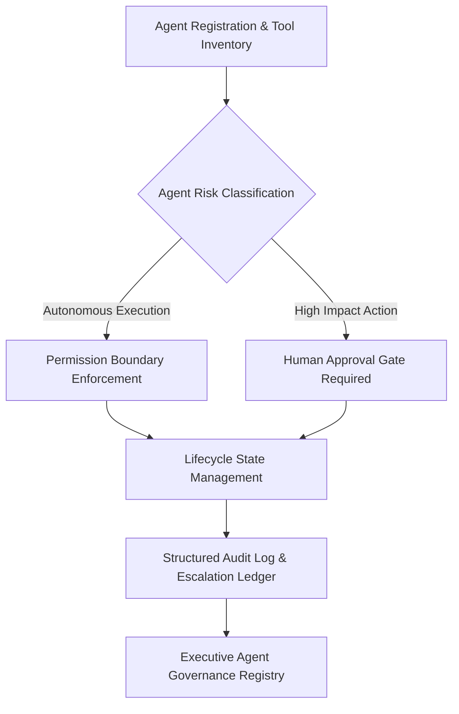

# AI Agent Governance Registry — Executive Showcase

  

  <strong>Autonomous Agent Inventory, Risk Classification & Human-in-the-Loop Control Architecture</strong> 
  Enterprise Governance Framework for Autonomous AI Workflows & Tool Access Boundaries

  <a href="https://ai-governance-registry.vercel.app/"><strong>Live Interactive Web Application</strong></a> •
  <a href="https://www.jovanfranco.com"><strong>Website & Executive Insights</strong></a> •
  <a href="https://github.com/jovfranco-tech"><strong>GitHub Profile</strong></a>

---

## Executive Overview

The **AI Agent Governance Registry** is an architectural portfolio showcase designed to address the governance challenges introduced by autonomous AI agents, multi-agent orchestrations, and tool-calling systems. It demonstrates how enterprise technology leaders can maintain explicit ownership, permission boundary enforcement, risk tiering, and human oversight over connected agentic workflows.

---

## Live Interactive Application

Experience the functional web application interface directly in your browser:
👉 **[Open Live Demo: AI Agent Governance Registry](https://ai-governance-registry.vercel.app/)**

> [!NOTE]
> **Portfolio Showcase & Synthetic Data Scope**:
> This repository is a documentation-only portfolio showcase. The live demonstration operates with representative synthetic agent configurations and deterministic scenarios. Persistence in the public portfolio application is browser-local (`localStorage`) and synthetic. It does not imply production IAM enforcement, production API isolation, immutable storage, or live enterprise credentials.

---

## High-Level System Architecture

---

## Key Functional Capabilities

1. **Centralized Agent Inventory & Ownership**:
   - Explicit tracking of internal and third-party AI agents, assigned business owners, and target operational domains.
   - Clear lifecycle state tracking (Draft, Evaluation, Authorized, Suspended, Decommissioned).

2. **Risk Tiering & Permission Boundaries**:
   - Categorization of agent capabilities by risk tier (Low, Medium, High, Critical).
   - Definition of tool access boundaries, API call limits, read vs. write permissions, and external network constraints.

3. **Human-in-the-Loop Oversight Gates**:
   - Human sign-off triggers for high-impact autonomous actions, policy exceptions, or elevated privilege requests.
   - Structured escalation ledger for audit review.

4. **Connected System Dependency Mapping**:
   - Visual dependency mapping connecting autonomous agents to underlying databases, microservices, and external APIs.

---

## Verified Technology Stack

- **Frontend**: React 18, TypeScript 5, Vite 5
- **State & Architecture**: Typed `useReducer` state model, versioned `localStorage` persistence
- **Styling**: Custom CSS design tokens

---

## Responsible AI & Governance Limitations

- **Supervised Autonomy**: Autonomous agent execution must operate within predefined boundary constraints. Operational actions affecting production data require explicit human authorization.
- **Non-Automated Compliance**: This registry system serves as a decision-support prototype. Organizational deployment requires alignment with corporate security policies and IAM infrastructure.

---

## Intellectual Property & Licensing

© Jovan Franco. All Rights Reserved.  
This repository is provided strictly as a public portfolio showcase and architectural overview. Reproduction, redistribution, or commercial use of this material without prior written consent is strictly prohibited.

## Repository consolidation (2026-11-25)

This repository keeps a single branch, `main`. Branch heads are preserved as `archive/20261125/*` tags.
Content that only existed on branches is under [docs/history/recovered-20261125/](docs/history/recovered-20261125/INDEX.md), as historical material.
