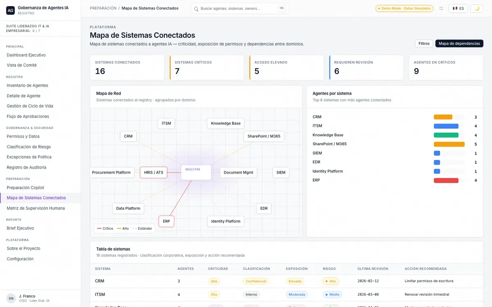
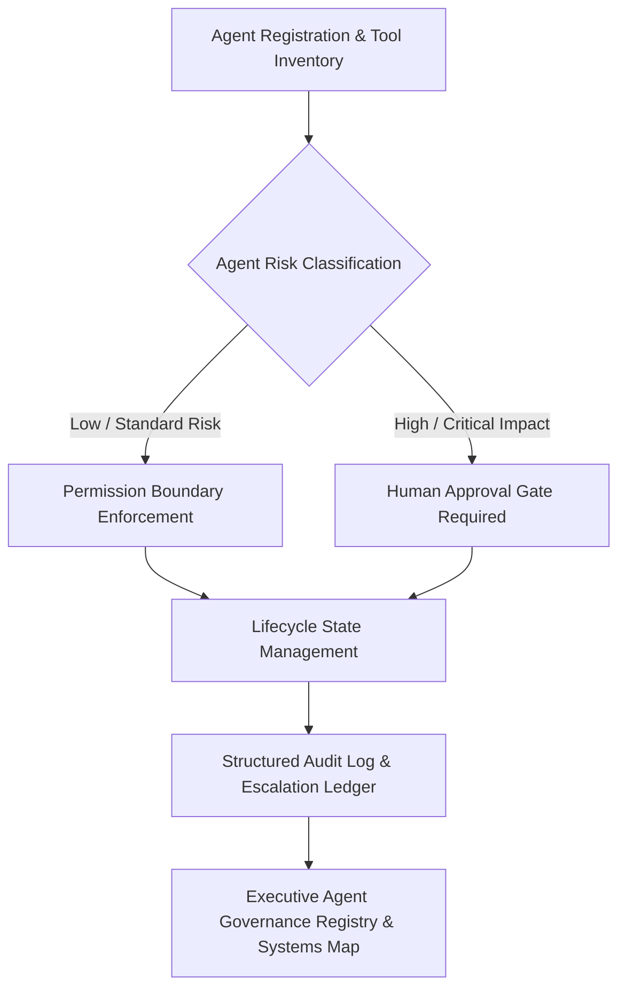

# AI Agent Governance Registry — Executive Showcase

  

  <strong>Autonomous Agent Inventory, Risk Classification & Human-in-the-Loop Control Architecture</strong> 
  Enterprise Governance Framework for Autonomous AI Workflows & Tool Access Boundaries

  <a href="https://ai-governance-registry.vercel.app/"><strong>Live Interactive Web Application</strong></a> •
  <a href="https://www.jovanfranco.com"><strong>Website & Executive Insights</strong></a> •
  <a href="https://github.com/jovfranco-tech"><strong>GitHub Profile</strong></a>

---

## Executive Overview & Problem Statement

The **AI Agent Governance Registry** is an architectural portfolio showcase designed to address the operational, security, and accountability challenges introduced by autonomous AI agents, multi-agent orchestrations, and tool-calling workflows.

As organizations adopt AI agents connected to internal systems (CRM, ITSM, ERP, HRIS, Identity Platforms, and Knowledge Bases), teams face four recurring governance gaps:
- **Shadow Agent Proliferation**: Lack of a centralized inventory identifying active agents, assigned business owners, and lifecycle states.
- **Unbounded Tool Permissions**: Difficulty enforcing read vs. write constraints, API limits, and external network boundaries across agent tools.
- **Unclear Risk Tiering**: Absence of standardized criticality and exposure classification across connected enterprise systems.
- **Missing Human-in-the-Loop Accountability**: Lack of formal approval gates, policy exception tracking, and auditable escalation logs for high-impact actions.

This showcase demonstrates an executive control-plane model for maintaining explicit ownership, permission boundaries, risk tiering, and human oversight over connected agentic workflows.

---

## Repository Scope vs. External Live Application

> [!NOTE]
> **Portfolio Showcase & Synthetic Data Scope**:
> This repository (`ai-agent-governance-registry-showcase`) is a **documentation-only portfolio showcase**. It contains only this `README.md` and the UI overview image ([assets/agent-registry-overview.webp](assets/agent-registry-overview.webp)). The live demonstration hosted externally at [ai-governance-registry.vercel.app](https://ai-governance-registry.vercel.app/) operates with representative synthetic agent configurations and deterministic scenarios (`Demo Mode · Datos Simulados` as seen in the UI preview). Persistence in the public portfolio application is browser-local (`localStorage`) and synthetic; it does not provide production IAM enforcement, production API isolation, immutable storage, or live enterprise credentials.

| Artifact / Surface | Location | Verified State in `HEAD` |
| :--- | :--- | :--- |
| Showcase Documentation | [README.md](README.md) | Present in repository |
| UI Overview Asset | [assets/agent-registry-overview.webp](assets/agent-registry-overview.webp) | Present in repository |
| Application Source Code (`src/`, `package.json`) | External / Separate from this repo | Not stored in this repository |
| Live Interactive Demo | [ai-governance-registry.vercel.app](https://ai-governance-registry.vercel.app/) | External Vercel deployment |

---

## Capabilities Showcased

Based on the showcase architecture and the verified UI overview in [assets/agent-registry-overview.webp](assets/agent-registry-overview.webp), the governance model covers the following functional domains:

1. **Centralized Agent Inventory & Lifecycle Ownership**:
   - Explicit tracking of internal and third-party AI agents, assigned business owners, and target operational domains.
   - Lifecycle state tracking (`Draft`, `Evaluation`, `Authorized`, `Suspended`, `Decommissioned`).
2. **Risk Tiering & Permission Boundaries**:
   - Categorization of agent capabilities and connected systems by risk and criticality (`Low`, `Medium`, `High`, `Critical`).
   - Definition of tool access boundaries, read vs. write exposure, and policy exception tracking.
3. **Human-in-the-Loop Oversight & Auditability**:
   - Human approval flows and supervision matrices for high-impact autonomous actions, policy exceptions, and elevated privilege requests.
   - Structured audit log and escalation ledger for committee and executive review.
4. **Connected System Dependency Mapping**:
   - Visual dependency mapping connecting the agent registry to underlying enterprise domains (such as `CRM`, `ITSM`, `Knowledge Base`, `SharePoint / M365`, `SIEM`, `EDR`, `Identity Platform`, `ERP`, `Data Platform`, `HRIS / ATS`, `Document Mgmt`, and `Procurement Platform`).
   - UI navigation modules depicted in the showcase screenshot (displayed in Spanish with a `Demo Mode · Datos Simulados` indicator): *Dashboard Ejecutivo*, *Vista de Comité*, *Inventario de Agentes*, *Detalle de Agente*, *Gestión de Ciclo de Vida*, *Flujo de Aprobaciones*, *Permisos y Datos*, *Clasificación de Riesgo*, *Excepciones de Política*, *Registro de Auditoría*, *Preparación Copilot*, *Mapa de Sistemas Conectados*, *Matriz de Supervisión Humana*, and *Brief Ejecutivo*.

---

## Conceptual Governance Architecture

---

## Technology Stack & Dependencies (Scope Clarification)

- **Verified Contents in This Repository (`HEAD`)**:
  - Markdown documentation (`README.md`) and one WebP image asset (`assets/agent-registry-overview.webp`).
  - Zero application source files, zero `package.json` manifests, and zero runtime or build dependencies exist inside this repository.
- **External Live Demo Stack (Unverified from This Repository)**:
  - Previously documented for the external web demo as **React 18**, **TypeScript 5**, **Vite 5**, a typed `useReducer` state model, versioned `localStorage` persistence, and custom CSS design tokens.
  - Because the application codebase is not hosted inside `ai-agent-governance-registry-showcase`, those dependencies and versions cannot be verified from files in this repository.
- **External References & Sibling Portfolio Context**:
  - Live interactive demo: [https://ai-governance-registry.vercel.app/](https://ai-governance-registry.vercel.app/)
  - Portfolio & executive insights: [https://www.jovanfranco.com](https://www.jovanfranco.com)
  - GitHub profile: [https://github.com/jovfranco-tech](https://github.com/jovfranco-tech)
  - Sibling application repository referenced in the portfolio register: `ai-agent-governance-registry` (tracked independently outside this showcase repo).

---

## Local Setup, Environment Variables & Data Model

- **Installation & Local Execution**:
  - There are **no build manifests (`package.json`), source code, or runnable scripts** in this repository. Cloning this repository provides only `README.md` and `assets/agent-registry-overview.webp`; no local application server can be installed or executed from this checkout.
- **Environment Variables**:
  - None required or referenced (`0` `.env.example` files and `0` code-level environment variable references in this repository).
- **Data Model & Migrations**:
  - None in this repository (`0` database schemas or migration files). Per the showcase documentation, the external live demo relies solely on synthetic data persisted in browser `localStorage`.

---

## Testing, Quality & Security Posture

- **Automated Test Suites & CI/CD**:
  - `0` test files and `0` `.github/workflows/*` files exist in this repository. Application unit/integration tests are not hosted or runnable here (`NOT_STARTED` / not applicable for a documentation-only showcase).
- **Documentation Quality Checks**:
  - `README.md` structure, Mermaid diagram syntax, secret-pattern scanning, and relative asset links were validated locally after editing.
- **Security & Privacy**:
  - **Zero Live Secrets or PII**: Verified that this repository contains no credentials, tokens, API keys, environment files, or real customer/personal data.
  - **Supervised Autonomy**: Any real-world adoption of this governance model requires human authorization gates for production-impacting actions.
  - **Non-Automated Compliance**: This showcase is a conceptual prototype; organizational deployment requires integration with corporate security policies, enterprise IAM, and audited persistence layers.

---

## Roadmap & Portfolio Reconciliation Status (`2026-11-23`)

In the portfolio register (`AEAS_PORTFOLIO_ROADMAP_REGISTER_20261120.md`), `ai-agent-governance-registry-showcase` is explicitly classified under **Showcases, Sandboxes, Labs, Websites & Demos** (*Non-production showcases/websites/demos; verify zero live secrets or unapproved PII/claims*), separate from the sibling application repository `ai-agent-governance-registry`. It does not appear in `AEAS_TOTAL_GLOBAL_COMPLETION_SCORECARD_20261121.json` or `AEM_MASTER_ROADMAP_RECONCILIATION_2026-10-22.md`.

| Track / Component | Status | Scope & Verified Evidence (`2026-11-23`) |
| :--- | :--- | :--- |
| Executive Showcase Documentation & Visual UI Overview | `IMPLEMENTED` / `VERIFIED` | `2/2` showcase artifacts present in `HEAD` (`README.md`, `assets/agent-registry-overview.webp`); PR `#1` merged (`a1abbdc`). |
| Interactive Web Demo (External Vercel Deployment) | `PARTIALLY_IMPLEMENTED` | External demo URL (`https://ai-governance-registry.vercel.app/`) documented; source code and runtime tests are outside this repository. |
| Source Code, Test Suite & CI/CD inside This Repo | `NOT_STARTED` | Intentionally excluded (`0` source files, `0` test files, `0` workflows); repository is documentation-only by design. |
| Enterprise IAM, Immutable Audit Backend & Production Controls | `NOT_STARTED` | Not `PRODUCTION_READY`. External demo uses synthetic browser-local `localStorage` without backend isolation or enterprise SSO. |
| External Adoption Dependencies | `BLOCKED_EXTERNAL` | Production governance usage requires backend persistence, corporate IAM/IdP integration, and independent security verification in an application repository. |

---

## Deployment & Operations

- **This Repository**: Static documentation and asset hosting on GitHub (`main` branch); no deployment configuration, server runtime, or GitHub Actions workflows are present.
- **External Demo**: Hosted independently at [https://ai-governance-registry.vercel.app/](https://ai-governance-registry.vercel.app/) for interactive portfolio demonstration using synthetic data.

---

## Verified Repository Links

- [README.md](README.md) — Executive showcase documentation and reconciliation record
- [assets/agent-registry-overview.webp](assets/agent-registry-overview.webp) — Connected Systems Map & Agent Governance Registry UI preview

---

## Intellectual Property & Licensing

© Jovan Franco. All Rights Reserved.  
This repository is provided strictly as a public portfolio showcase and architectural overview. Reproduction, redistribution, or commercial use of this material without prior written consent is strictly prohibited.
